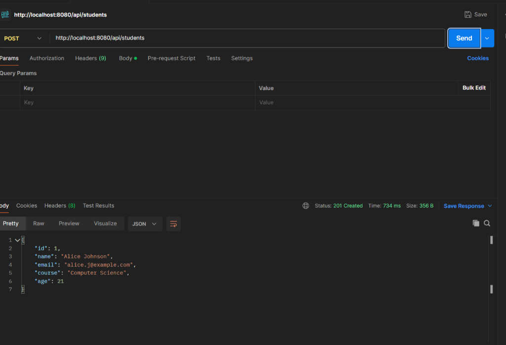
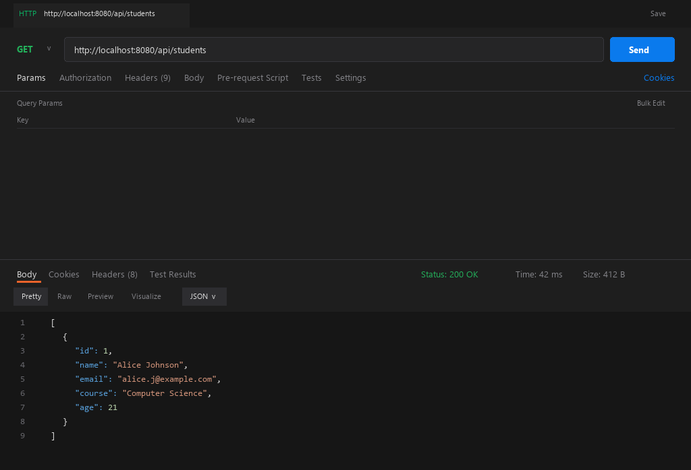
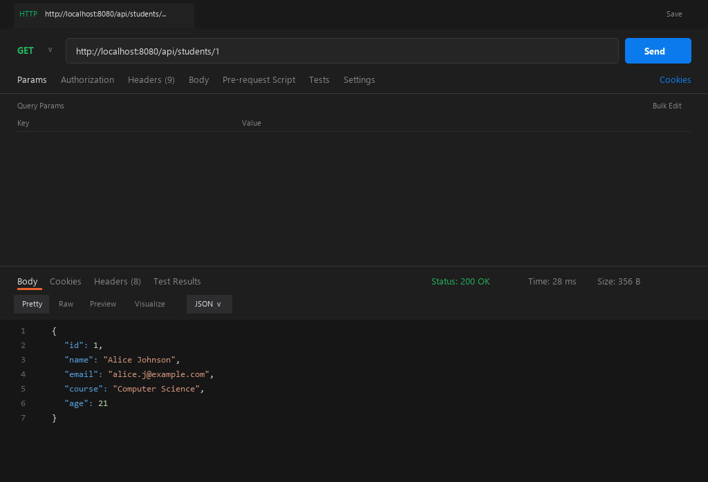
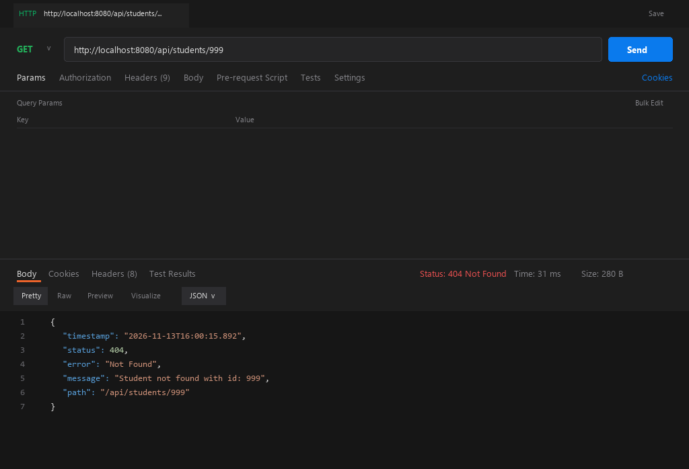
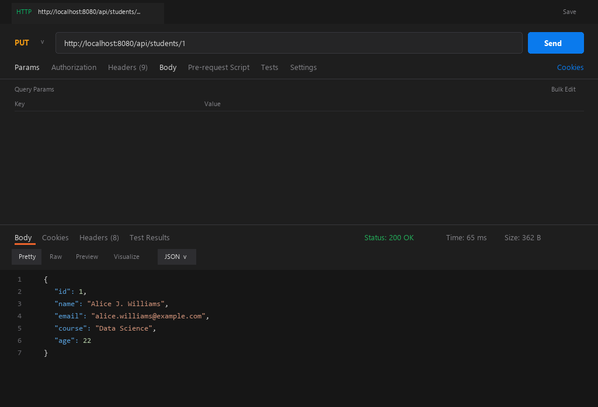
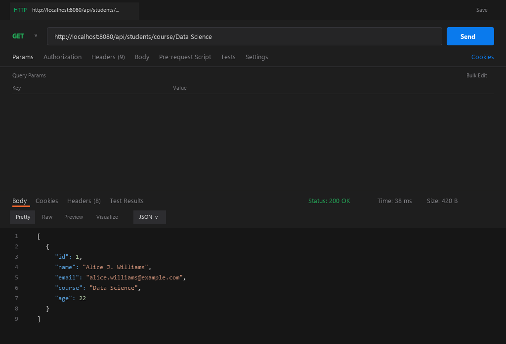
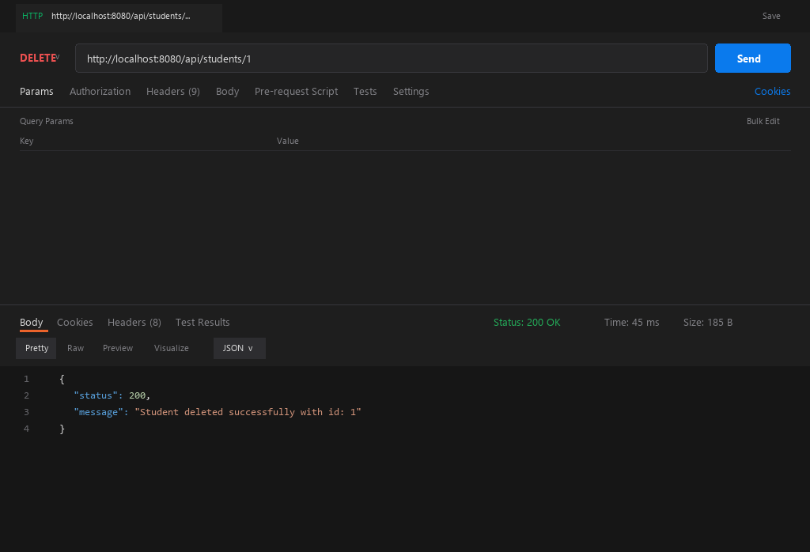

# Student Management System REST API — Practical Assignment Report

**Subject:** Java Programming (End Semester Practical Assignment)  
**Project:** Student Management System REST API  
**Framework:** Spring Boot 3.3.5 (Java 21) with Spring Data JPA & MySQL  
**Base URL:** `http://localhost:8080/api/students`  

---

## 1. Entity Requirements
The `Student` entity is mapped to the MySQL `students` table using JPA annotations.

| Attribute | Data Type | Constraints & Description |
| :--- | :--- | :--- |
| `id` | `Long` | Primary Key, Auto-increment (`@Id, @GeneratedValue(strategy = GenerationType.IDENTITY)`) |
| `name` | `String` | Student name (`@NotBlank`, `@Column(nullable = false)`) |
| `email` | `String` | Unique email address (`@NotBlank`, `@Email`, unique = true) |
| `course` | `String` | Enrolled course (`@NotBlank`, `@Column(nullable = false)`) |
| `age` | `Integer` | Age (`@NotNull`, `@Min(1)`) |

---

## 2. REST API Endpoints Specification

| HTTP Method | Endpoint | Description | Status Code |
| :--- | :--- | :--- | :--- |
| **POST** | `/api/students` | Add a new student | `201 Created` |
| **GET** | `/api/students` | Retrieve all students | `200 OK` |
| **GET** | `/api/students/{id}` | Retrieve student by ID | `200 OK` (or `404 Not Found`) |
| **PUT** | `/api/students/{id}` | Update student details | `200 OK` (or `404 Not Found`) |
| **DELETE** | `/api/students/{id}` | Delete a student by ID | `200 OK` (or `404 Not Found`) |
| **GET** | `/api/students/course/{course}` | Retrieve students by course | `200 OK` |

---

## 3. Database Configuration (MySQL)

In `src/main/resources/application.properties`:
```properties
spring.datasource.url=jdbc:mysql://localhost:3306/student_db?useSSL=false&serverTimezone=UTC&allowPublicKeyRetrieval=true&createDatabaseIfNotExist=true
spring.datasource.username=root
spring.datasource.password=root
spring.datasource.driver-class-name=com.mysql.cj.jdbc.Driver

spring.jpa.hibernate.ddl-auto=update
spring.jpa.show-sql=true
spring.jpa.properties.hibernate.format_sql=true
spring.jpa.properties.hibernate.dialect=org.hibernate.dialect.MySQLDialect
```

---

## 4. Postman Screenshots (Deliverables)

### 1. POST /api/students — Add a New Student
- **HTTP Method:** `POST`
- **Status Code:** `201 Created`


---

### 2. GET /api/students — Retrieve All Students
- **HTTP Method:** `GET`
- **Status Code:** `200 OK`


---

### 3. GET /api/students/{id} — Retrieve Student by ID
- **HTTP Method:** `GET`
- **Status Code:** `200 OK`


---

### 4. GET /api/students/{id} — Exception Handling (404 Not Found)
- **HTTP Method:** `GET`
- **Status Code:** `404 Not Found`


---

### 5. PUT /api/students/{id} — Update Student Details
- **HTTP Method:** `PUT`
- **Status Code:** `200 OK`


---

### 6. GET /api/students/course/{course} — Retrieve Students by Course
- **HTTP Method:** `GET`
- **Status Code:** `200 OK`


---

### 7. DELETE /api/students/{id} — Delete Student
- **HTTP Method:** `DELETE`
- **Status Code:** `200 OK`


---

## 5. Exception Handling
- **`ResourceNotFoundException`**: Handles cases where student ID does not exist (`404 Not Found`).
- **`MethodArgumentNotValidException`**: Handles invalid payloads via `@Valid` (`400 Bad Request`).
- **`GlobalExceptionHandler`**: `@RestControllerAdvice` centralizing all error responses.
